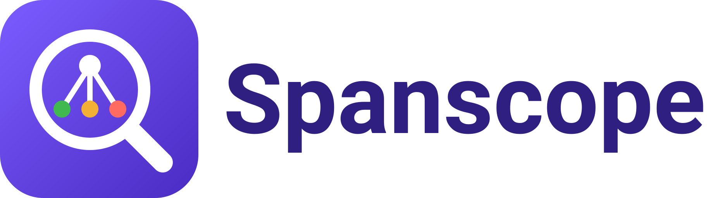

<p align="center"></p>

# Spanscope

**See every span of control at a glance.**

A **Silverlight DevTech** project · © 2026 Silverlight DevTech. Source-available under the [PolyForm Noncommercial License 1.0.0](LICENSE.md).

More apps: https://lance6x5.github.io/

Upload an org roster CSV and get an interactive org chart that flags spans of control that are too wide or too narrow.

**Live app:** https://lance6x5.github.io/org-span-visualizer/

**Privacy:** your file never leaves this browser. Parsing, validation, layout, and export all run client-side. A strict Content-Security-Policy (`connect-src 'self'`) stops the page from sending data to any other origin. Nothing is saved unless you turn on **Save session locally** (stored in this browser's IndexedDB only).

## Features

- **CSV input**: drag and drop or file picker, parsed locally with PapaParse. Includes a downloadable 40-person sample CSV.
- **Column mapping**: map your own headers to `employee_id`, `name`, `title`, `manager_id` (required) and `department`, `location`, `employment_type` (optional). Common names are auto-detected.
- **Validation**: a "Data issues" panel reports missing managers, multiple roots, circular reporting chains, duplicate IDs, and blank IDs. Bad data is repaired (cycles broken, orphans promoted) rather than crashing the app.
- **Span rules**: configurable thresholds (default: too narrow < 4, too wide > 10) and an option to count or exclude contractors. Managers are colored green (healthy), amber (narrow), or red (wide).
- **Visualization**: collapsible, zoomable, pannable d3 tree. Each node shows name, title, direct-report count, and total org size. Search to find and focus on a person. Toggle between the tree and a compact list view.
- **Analytics**: headcount, managers, layers, average and median span, flagged managers sorted by severity (click to jump), and a span histogram.
- **Export**: flagged managers as CSV or TSV (plus "Copy for Excel"), the current chart view as PNG or SVG, and the whole session as JSON (re-importable).
- **Reset all data** with a confirmation step.
- Installable **PWA** that works offline; light and dark mode; keyboard accessible.

## CSV format

```csv
employee_id,name,title,manager_id,department,location,employment_type
E001,Ava Chen,Chief Executive Officer,,Executive,Austin,FTE
E002,Marcus Webb,Chief Technology Officer,E001,Engineering,Austin,FTE
```

Leave `manager_id` blank for the top of the org. `employment_type` values containing "contract", "contingent", "vendor", "temp", or "consult" count as contractors.

## Feedback & issues

Found a bug or have an idea? Use **Feedback** in the app header, or go straight to [Issues](https://github.com/lance6x5/org-span-visualizer/issues):

- [Report a bug](https://github.com/lance6x5/org-span-visualizer/issues/new?template=bug_report.yml)
- [Request a feature](https://github.com/lance6x5/org-span-visualizer/issues/new?template=feature_request.yml)

The in-app links simply open GitHub in a new tab with the app version (and, for bugs, your browser string) pre-filled. No roster data is ever put in the link and the app makes no network calls. A free GitHub account is required. See [CONTRIBUTING.md](CONTRIBUTING.md) for the triage flow.

## Versioning

Spanscope follows [Semantic Versioning](https://semver.org/). The current version is shown in the app footer.

- **MAJOR**: breaking data/schema change (e.g. session JSON format or required CSV columns change incompatibly).
- **MINOR**: new features, backwards compatible.
- **PATCH**: bug fixes.

Release notes live in [CHANGELOG.md](CHANGELOG.md); each release is tagged `vX.Y.Z` and published on the [Releases](https://github.com/lance6x5/org-span-visualizer/releases) page.

## Local development

```bash
npm install
npm run dev      # start the dev server
npm test         # run unit tests (Vitest)
npm run build    # production build to dist/
npm run preview  # serve the production build locally
```

## Deploy (GitHub Pages)

1. Push this repo to GitHub with the default branch `main`.
2. One-time setup: **Repo Settings → Pages → Source: "GitHub Actions"**.
3. Every push to `main` (or a manual "Run workflow") runs `.github/workflows/deploy.yml`, which installs, tests, builds, and deploys `dist/`.

The Vite `base` is set to `/org-span-visualizer/`. If you fork under a different repo name, update `base`, `start_url`, and `scope` in `vite.config.js`.

## Project structure

```
src/
  App.jsx                 app state, routing, data menu
  components/             UploadView, MappingView, TreeView (d3), ListView,
                          SearchBox, Panels (settings/analytics/issues),
                          Histogram, ConfirmDialog
  lib/
    org.js                validation, tree building, span metrics (pure, tested)
    csv.js                PapaParse wrapper, column guessing, CSV/TSV export
    session.js            JSON export/import format
    storage.js            opt-in IndexedDB session + localStorage prefs
    download.js           Blob downloads, SVG/PNG chart export
    sample.js             embedded sample roster
    useHashRoute.js       hash routing (#/chart, #/list, #/map)
    feedback.js           pre-filled GitHub issue URLs (no API calls)
scripts/gen-icons.mjs     regenerates logo + PWA icons (no dependencies)
test/                     unit tests (Vitest)
```

## License

Spanscope is **source-available**, not open source in the OSI sense. It is licensed under the [PolyForm Noncommercial License 1.0.0](LICENSE.md) (SPDX: `PolyForm-Noncommercial-1.0.0`).

- **Free for noncommercial use:** personal, educational, research, nonprofit and other noncommercial use is allowed under the license terms.
- **Commercial use needs a separate license:** this includes selling it, hosting it as a paid service, or using it inside a business product. Commercial licenses are available from Silverlight DevTech; to ask, open a [GitHub issue on this repo](https://github.com/lance6x5/org-span-visualizer/issues).
- **Redistribution:** anyone who shares a copy must keep [LICENSE.md](LICENSE.md) and its `Required Notice:` line.

Third-party dependencies keep their own licenses.

## Trademarks

Spanscope and its logo are trademarks of Silverlight DevTech. The license covers the code only, not the names or logos, so forks must use a different name and logo.
